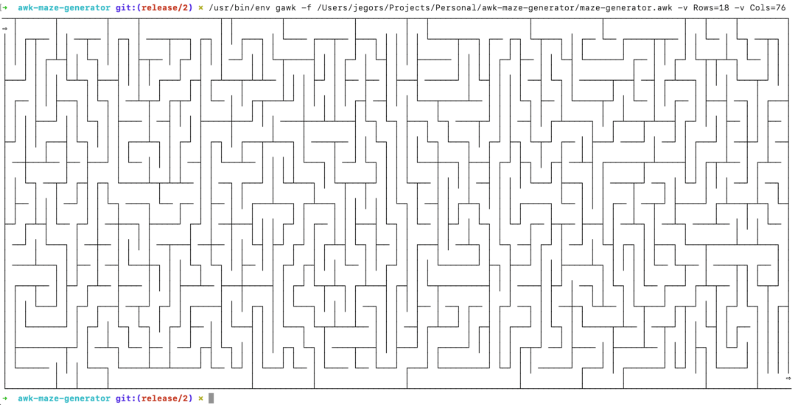
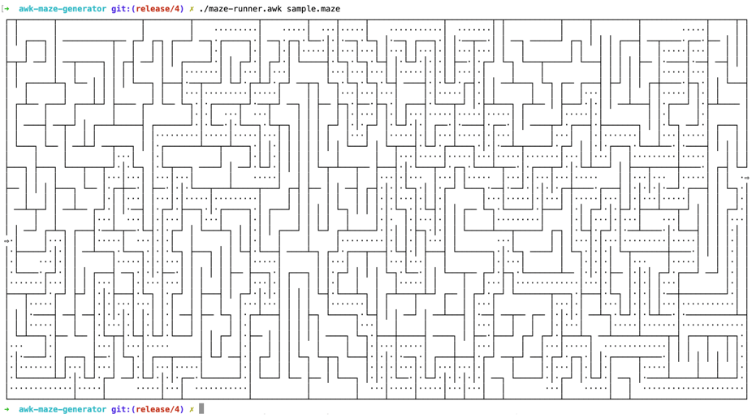

# AWK Maze Generator & Solver

[-blue?logo=exercism)](https://exercism.org/tracks/awk/exercises/mazy-mice)
[](LICENSE)

Pure **GNU AWK (`gawk`)** scripts for generating random **perfect mazes** (mazes without loops or isolated walls, guaranteeing a unique path between any two cells), validating their structure, and finding the solution path.

> [!NOTE]
> **Background & Exercism Connection**
> I originally created this repository as the reference implementation and test harness for the [**Mazy Mice**](https://exercism.org/tracks/awk/exercises/mazy-mice) exercise, which I authored for the [Exercism AWK Track](https://exercism.org/tracks/awk) (and which has since been adapted to other language tracks).

---

## Highlights & How It Works

* **Multiple Generation Algorithms:**
  * `maze-gen-one.awk` — Iterative Depth-First Search (DFS) using an explicit stack (`CellStack`) over a 1D array representation.
  * `maze-gen-two.awk` / `maze-generator.awk` — Recursive Backtracking algorithm over a 2D grid.
  * `maze-gen-asc.awk` — Recursive Backtracking generator rendered in pure ASCII (`##`) for environments without Unicode support.
* **Bitmask Box-Drawing Renderer:** Wall junctions are resolved dynamically by encoding the 4 cardinal neighbors (`N`, `E`, `S`, `W`) into a 4-bit integer (`1..16`) and indexing directly into a lookup string:
  ```awk
  substr(" │─└││┌├─┘─┴┐┤┬┼", 1 + n + 2 * e + 4 * s + 8 * w, 1)
  ```
* **Pathfinder (`maze-runner.awk`):** Reads any generated Unicode maze from `stdin` or a file and traces the unique path from the entrance (`⇨`) to the exit (`⇨`) using `⋅` markers.
* **Structural Verifier (`test-maze.awk`):** Validates dimensions, box-drawing wall connections, single entry/exit rules, absence of cycles, and full graph connectivity (used as the official test validator in Exercism's *Mazy Mice*).

---

## Quick Start

### Prerequisites

* **GNU Awk (`gawk`)** 4.0+ (required for `FPAT`, `ENDFILE`, and UTF-8 character handling)
* **[bats-core](https://github.com/bats-core/bats-core)** (optional, for running the automated test suite)
* **[mise](https://mise.jdx.dev/)** (optional, for managing tools and running tasks)

### Using `mise` (Recommended)

```shell
mise install
mise run generate              # Generate a random maze (8x36)
mise run generate-dfs          # Generate a maze using iterative DFS
mise run solve                 # Generate and immediately solve a maze
ROWS=12 COLS=40 mise run solve # Custom dimensions
SEED=42 mise run solve         # Reproducible maze + solution
mise run ascii                 # Generate an ASCII-only maze
mise run test                  # Run the BATS test suite
mise run test-fixtures         # Run structural verifier against test/*.maze
```

---

## Usage (Direct `gawk` CLI)

### 1. Generate a Random Maze

To generate a maze, use `maze-generator.awk` (or `maze-gen-one.awk` / `maze-gen-two.awk`). Specify the number of `Rows` and `Cols` (defaults to `8`×`16`), and an optional `Seed` parameter:

```shell
gawk -f maze-generator.awk -v Rows=8 -v Cols=36
```

If you specify a `Seed` value, you will get the exact same maze every time:

```shell
gawk -f maze-generator.awk -v Rows=8 -v Cols=36 -v Seed=42
```

#### Sample Output



#### Make Scripts Executable

You can set the execution flag on the scripts to run them directly:

```shell
chmod +x maze-generator.awk maze-runner.awk test-maze.awk
./maze-generator.awk -v Rows=8 -v Cols=36
```

### 2. Generate and Solve in a Unix Pipeline

Because the scripts act as standard Unix filters, you can pipe the generator directly into the solver:

```shell
gawk -f maze-generator.awk -v Rows=8 -v Cols=36 -v Seed=42 | gawk -f maze-runner.awk
```

Or save a maze to a file and solve it later:

```shell
./maze-generator.awk -v Rows=18 -v Cols=76 -v Seed=42 > docs/sample.maze
gawk -f maze-runner.awk docs/sample.maze
```

#### Sample Output of Path



### 3. Validate a Generated Maze

Run `test-maze.awk` to verify that a maze meets all structural requirements of a perfect maze:

```shell
gawk -f test-maze.awk -v Rows=18 -v Cols=76 docs/sample.maze
# Output: The maze is perfect.
```

You can also validate on the fly in a pipeline:

```shell
gawk -f maze-gen-one.awk -v Rows=10 -v Cols=25 | gawk -f test-maze.awk -v Rows=10 -v Cols=25
```

### 4. ASCII-Only Version

In case Unicode box-drawing characters are not supported on your terminal, `maze-gen-asc.awk` generates mazes using only ASCII characters (`##`):

```shell
gawk -f maze-gen-asc.awk -v Rows=9 -v Cols=21
```

#### Sample Output

```text
######################################################################################
##          ##              ##          ##                          ##              ##
##  ######  ##  ##########  ######  ##  ##  ##############  ######  ##  ##  ######  ##
##  ##          ##      ##      ##  ##  ##      ##      ##      ##  ##  ##      ##  ##
##  ##  ##########  ##  ######  ######  ######  ##  ##########  ######  ######  ##  ##
##  ##  ##          ##  ##  ##      ##      ##  ##          ##          ##      ##  ##
##  ######  ##########  ##  ######  ##  ##  ##  ######  ##  ##############  ######  ##
##      ##  ##  ##      ##      ##  ##  ##  ##      ##  ##              ##      ##  ##
##  ##  ##  ##  ##  ######  ##  ##  ##  ##  ######  ##  ##############  ######  ##  ##
##  ##          ##  ##  ##  ##  ##  ##  ##      ##  ##          ##      ##      ##  ##
##  ##############  ##  ##  ##  ##  ##  ##########  ##############  ##  ##  ######  ##
##  ##              ##      ##          ##      ##      ##          ##  ##  ##  ##  ##
##  ##  ##  ##########  ##################  ##  ######  ##  ######  ######  ##  ##  ##
##  ##  ##  ##      ##  ##                  ##  ##      ##  ##      ##      ##        
##  ##  ######  ##  ######  ##################  ##  ######  ######  ##  ##############
    ##      ##  ##          ##      ##          ##      ##      ##  ##  ##          ##
##  ######  ##  ##############  ##  ##  ##############  ######  ##  ##  ##  ######  ##
##      ##                      ##  ##                          ##  ##          ##  ##
######################################################################################
```

---

## Running Tests

Run the automated [BATS](https://github.com/bats-core/bats-core) test suite:

```shell
bats test-maze-generator.bats
```

Or run the fixture test script in `test/`:

```shell
./test/all-tests.sh
```
